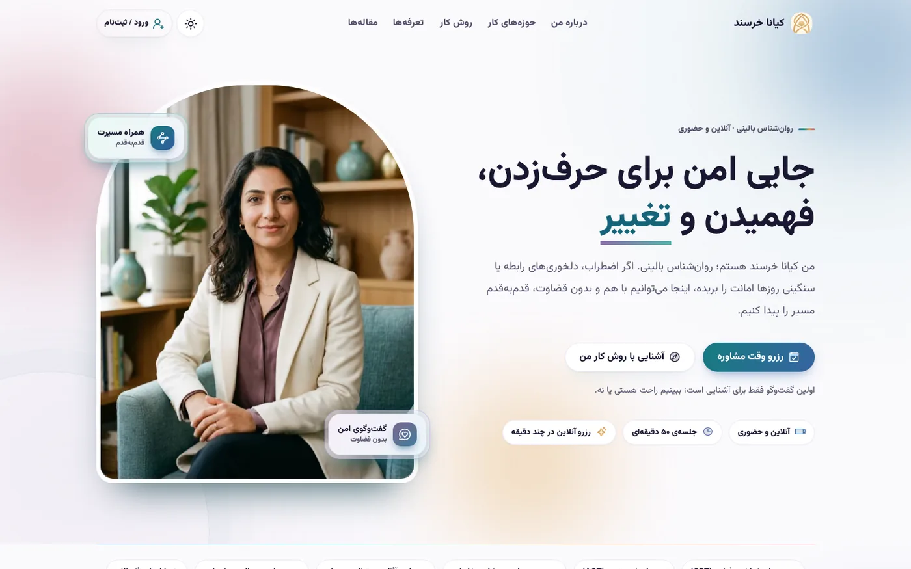
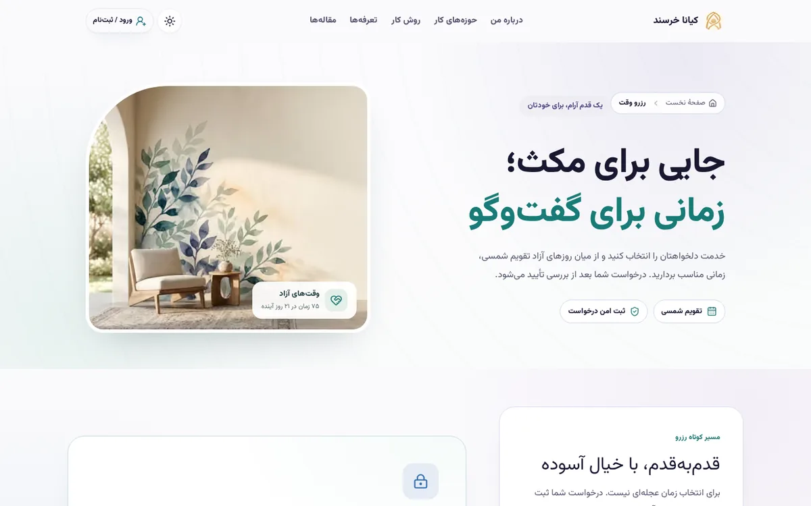
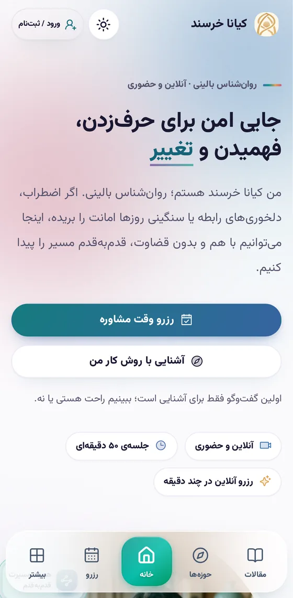
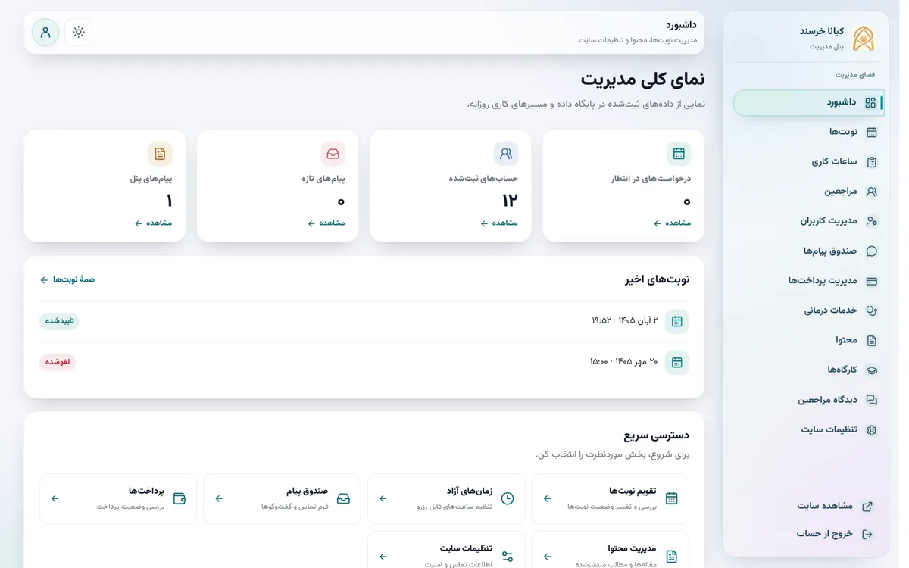
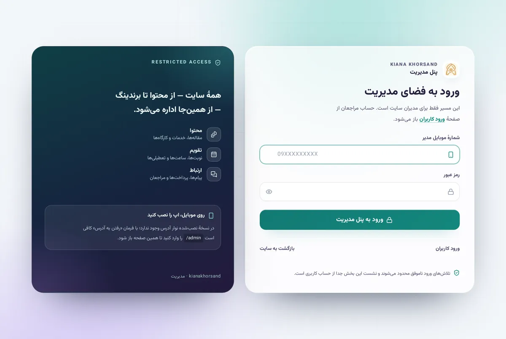
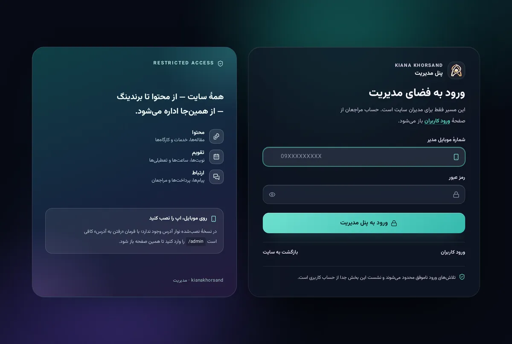
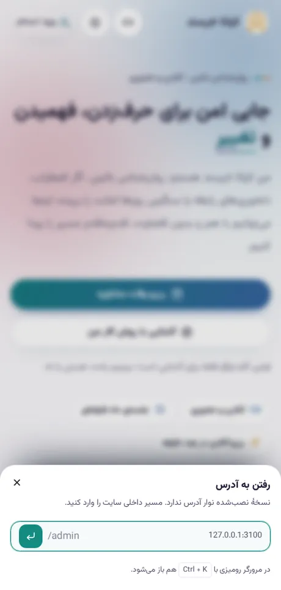

<div align="center">


# 🌿 کیانا خرسند

**جایی امن برای فهمیدن و تغییر** · _A safe space to understand and change_

وب‌سایت حرفه‌ای روان‌شناسی بالینی — فارسی، راست‌به‌چپ، موبایل‌محور، با پنل مدیریت کامل، تقویم شمسی، پرداخت، PWA و تست‌های سرتاسری.

<br />

[](https://nextjs.org)
[](https://react.dev)
[](https://www.typescriptlang.org)
[](https://tailwindcss.com)
[](https://www.mongodb.com)
[](https://playwright.dev)

[](#-pwa)
[](#-فارسی-و-راستبهچپ)
[](#-دسترس‌پذیری)
[](LICENSE)

[**🌐 نسخهٔ زنده**](https://kiana-khorsand.vercel.app) · [ویژگی‌ها](#-ویژگیها) · [شروع سریع](#-شروع-سریع) · [معماری](#-معماری)

</div>

---

## 📖 درباره پروژه

این مخزن یک **وب‌سایت کامل درمانی** است، نه یک قالب و نه یک دمو: صفحه‌های عمومی برای معرفی رویکرد و خدمات، فرم رزرو نوبت با تقویم شمسی، نظرات تأییدشده، ارزیابی‌های کوتاه، پنل کاربر برای نوبت‌ها و پرداخت‌ها، و پنل مدیریتی که تقریباً همهٔ محتوا را بدون دست‌زدن به کد اداره می‌کند.

سه اصل، شکل‌دهندهٔ همهٔ تصمیم‌ها بوده است:

| اصل                    | معنی در عمل                                                                                |
| :--------------------- | :----------------------------------------------------------------------------------------- |
| 🧘 **آرام و بی‌دردسر** | هیچ پرش چیدمان، هیچ فلش سفید، انیمیشن‌هایی که با `prefers-reduced-motion` خاموش می‌شوند    |
| 🎯 **درست تا آخر**     | اعتبارسنجی سمت سرور، کنترل دسترسی در هر Server Action، تست سرتاسری برای هر رفتار کاربرپسند |
| 🪶 **سبک**             | Server Components پیش‌فرض، صفر وابستگی اضافه، تصاویر WebP/AVIF، JS حداقلی                  |

> ✨ محتوای اصلی سایت — مقاله‌ها، کارگاه‌ها، حوزه‌ها، خدمات، تعرفه‌ها، پرسش‌های متداول، نظرات و متن صفحه‌ها — از پنل مدیریت ویرایش می‌شود و در پایگاه داده زندگی می‌کند، نه در کد.

---

## 🖼️ نگاهی به سایت

<div align="center">

**صفحهٔ نخست — دسکتاپ**



**رزرو وقت با تقویم شمسی**



<p>

&nbsp;&nbsp;

</p>

**ورود مدیران — شیشهٔ نازک، حلقهٔ فوکوس یک‌پیکسلی**



<p>

&nbsp;&nbsp;

</p>

</div>

---

## ✨ ویژگی‌ها

<table>
<tr><td width="50%" valign="top">

### 🌿 تجربهٔ عمومی

- صفحهٔ نخست با هیروی شناور، تایم‌لاین، کاروسل و CTA شیشه‌ای
- مقاله‌ها با جست‌وجو، فیلتر حوزه، صفحه‌بندی و نشان خودکار از عنوان
- حوزه‌های کاری، خدمات، تعرفه‌ها، درباره من، روش کار، پرسش‌های متداول
- کارگاه‌ها با تقویم شمسی و رزرو آنلاین
- نظرات مراجعان با تأیید پیش از انتشار
- ارزیابی‌های کوتاه و تعاملی (کوییز چندبخشی)

</td><td width="50%" valign="top">

### 📅 رزرو و پرداخت

- تقویم شمسی (`@daypicker/persian`) و انتخاب بازهٔ زمانی آزاد
- اعتبارسنجی سمت سرور روی هر درخواست
- جلوگیری از رزرو تکراری با یکپارچگی داده در Mongo
- فاکتور دستی و پیگیری پرداخت در پنل مدیریت
- یادداشت جلسه با رمزنگاری AES-256-GCM در سطح کاربر

</td></tr>
<tr><td valign="top">

### 🛡️ پنل مدیریت

- مدیریت مقاله‌ها با **Markdown + پیش‌نمایش زنده** و آپلود کاور
- تقویم روز/هفته/ماه، بستن بازهٔ تعطیلی، تغییر سریع وضعیت نوبت
- مدیریت کاربران، مراجعان، خدمات، کارگاه‌ها، نظرات و تنظیمات سایت
- صندوق پیام، پاسخ به گفت‌وگوها
- خروجی CSV امن (محافظت در برابر CSV injection)

</td><td valign="top">

### 👤 پنل کاربر

- نوبت‌ها، پرداخت‌ها، دوره‌ها و ارزیابی‌ها
- پیام خصوصی با ادمین
- یادداشت‌های جلسه (رمزنگاری‌شده)
- آپلود آواتار — تبدیل به WebP مربعی بدون EXIF در سمت سرور
- تغییر رمز عبور و تنظیمات حساب

</td></tr>
</table>

### 🔐 احراز هویت و جداسازی نقش‌ها

- ورود/ثبت‌نام با **شمارهٔ موبایل + رمز عبور** روی [Better Auth](https://www.better-auth.com)
- دو مسیر ورود مستقل: کاربر عادی از `/login` و مدیر فقط از `/admin/login`
- ادمین بیرون از پنل مثل هر کاربر دیگری رفتار می‌کند — هیچ لینکی به پنل در منوی حساب او نیست
- ورودی مدیران یک صفحهٔ مستقل با فیلدهای شیشه‌ای است: پلیت نیمه‌شفاف با بلور پس‌زمینه، خط مویی در حالت عادی و یک حلقهٔ یک‌پیکسلی همرنگ برند هنگام فوکوس
- محافظت از مسیرها در سه لایه: `middleware`، چک نقش در Server Action و بررسی مالکیت داده
- محدودسازی تلاش ورود (HMAC روی شمارهٔ موبایل + پنجرهٔ زمانی ۱۵ دقیقه)

### 🎬 حرکت و تعامل

- [Motion](https://motion.dev) با `LazyMotion` + کامپوننت سبک `m` — فقط بخش لازم کتابخانه بار می‌شود
- کالیبراسیون مشترک فنرها، مدت‌ها و فاصله‌ها در `src/lib/motion-tokens.ts`
- احترام کامل به `prefers-reduced-motion`؛ مسیر کاهش حرکت در سطح کامپوننت
- **شیشهٔ فوکوس همه‌جا**: هر `input`/`textarea`/`select` در لحظهٔ فوکوس شفاف، بلورین و برجسته می‌شود — حلقهٔ ۱px، هالهٔ ۷px، درخشش درونی و یک بازتاب ملایم بالا؛ سه سطح accent (`teal` سایت، `violet` پنل، `plum` صفحه‌های حساب)
- کاروسل با [Embla](https://www.embla-carousel.com): بدون loop، بدون autoplay اجباری، در موبایل هر اسلاید دقیقاً وسط
- کنترل‌های قبل/بعد با جهت درست RTL، دکمه‌های غیرفعال در لبه‌های واقعی

### 📲 PWA

- `manifest.webmanifest` بر پایهٔ [راهنمای رسمی Next.js](https://nextjs.org/docs/app/guides/progressive-web-apps): `id`, `scope`, `start_url`, `display: standalone` با `display_override`, جهت `rtl`, زبان `fa`, رنگ تم، و `launch_handler: navigate-existing`
- آیکون ۱۹۲ و ۵۱۲ در دو نسخه: `any` برای لانچر و `maskable` برای برش دایره‌ای اندروید؛ طرح داخل دایرهٔ ایمن ۸۰٪ می‌ماند تا هرگز نبُرد
- دو اسکرین‌شات واقعی (باریک ۵۶۰×۱۱۴۰ و عریض ۱۴۰۰×۸۷۵) تا شیت نصب، خودِ اپ را نشان بدهد نه یک بنر خام
- Service Worker دست‌نویس:
  - **cache-first** برای فایل‌های ثابت (نام فایل‌ها hash دارند، پس هرگز کهنه نیستند)
  - **network-first** برای ناوبری، با صفحهٔ آفلاین به‌عنوان جایگزین
  - **هیچ صفحهٔ شخصی کش نمی‌شود**: سرور فقط برای پاسخ‌های بی‌نشست هدر `x-offline-cacheable` می‌گذارد و مرورگر بر اساس همان تصمیم می‌گیرد — نام کاربر روی دستگاه مشترک باقی نمی‌ماند
  - مسیرهای خصوصی (`/admin`, `/dashboard`, `/api`, `/login`, `/book`) هرگز کش نمی‌شوند و هنگام خروج، کش پاک می‌شود
- هدرهای امنیتیِ مخصوص worker طبق مستندات: `Content-Type` درست، `Cache-Control: no-store` و `CSP: default-src 'self'; script-src 'self'`؛ ثبت با `updateViaCache: "none"` تا نسخهٔ اصلاح‌شده بی‌درنگ به اپ نصب‌شده برسد
- **نصب**: در کروم/اندروید همان پیشنهاد خود مرورگر استفاده می‌شود (`beforeinstallprompt`)؛ در Safari آیفون که چنین رویدادی ندارد، همان دکمه شیت راهنمای «Share → Add to Home Screen» را باز می‌کند. در نسخهٔ نصب‌شده یا پس از رد کردن، دکمه پنهان می‌ماند
- در نسخهٔ نصب‌شده نوار آدرس وجود ندارد؛ فرمان **«رفتن به آدرس»** در هدر همان کار را می‌کند. کافی است `/admin` وارد شود تا صفحهٔ ورود مدیران باز شود (یا `Ctrl/⌘ + K`). فقط مسیرهای همین سایت پذیرفته می‌شوند
- عمداً هیچ shortcut‌ای به `/admin` در `manifest` نیست: منیفست عمومی است و همهٔ نصب‌کننده‌ها آن را در منوی نگه‌داشتن آیکون می‌بینند، که با قاعدهٔ «ادمین بیرون پنل مثل کاربر عادی است» در تضاد می‌افتد
- صفحهٔ آفلاین کاملاً سمت سرور و بدون جاوااسکریپت است، با حرکت‌های CSS که در `prefers-reduced-motion` خاموش می‌شوند
- **صفحهٔ راه‌اندازی** (`BootSplash`) در HTML اولیه رندر می‌شود و فقط در حالت نصب‌شده دیده می‌شود: نشان برند با هالهٔ تنفس‌کننده، نام، شعار، سه نقطهٔ لودینگ و یک ریل نور. `background_color` مانیفست دقیقاً همان رنگ است تا اسپلش سیستم‌عامل یک‌دست به این صفحه وصل شود. `SplashGate` بعد از آماده‌شدن فونت‌ها (و حداقل ۵۲۰ms) با محو شدن آن را برمی‌دارد

### 🔎 سئو و اشتراک‌گذاری

- متادیتای یکجا در `src/lib/public-metadata.ts` — عنوان، توضیح، canonical و کارت اجتماعی
- کارت Open Graph ۱۲۰۰×۶۳۰ با `og:image:type/width/height`
- `sitemap.xml` و `robots.txt` داینامیک، با تصاویر
- داده‌های ساخت‌یافته: `BlogPosting` برای مقاله‌ها، `BreadcrumbList` برای مسیر راهنما
- هاست canonical از خودِ دیپلوی گرفته می‌شود تا لینک‌ها هرگز به میزبان مرده اشاره نکنند

---

## 🛠️ استک

| لایه           | انتخاب                                | چرا                                       |
| :------------- | :------------------------------------ | :---------------------------------------- |
| **فریم‌ورک**   | Next.js 16.4 (App Router) + Turbopack | Server Components، Server Actions، استریم |
| **زبان**       | TypeScript 5 (strict)                 | مرزهای داده بدون `any`                    |
| **رابط**       | Tailwind CSS 4 + Radix UI + shadcn/ui | دسترس‌پذیری آماده، استایل بدون runtime    |
| **حرکت**       | Motion 14                             | API اعلامی و سبک با `LazyMotion`          |
| **کاروسل**     | Embla Carousel 8                      | کنترل کامل روی RTL و لبه‌ها               |
| **داده**       | MongoDB 7 + `mongodb` driver          | مدل سند انعطاف‌پذیر برای محتوای ویرایشی   |
| **اعتبارسنجی** | Zod 4                                 | یک شِما برای فرم و سرور                   |
| **احراز هویت** | Better Auth 1.7                       | نشست کوکی، پلاگین‌ها، بدون JWT دستی       |
| **تاریخ**      | `@daypicker/persian`                  | تقویم شمسی واقعی، نه تبدیل سمت کلاینت     |
| **مارک‌داون**  | markdown-it 15 + react-markdown       | ویرایش و نمایش مقاله                      |
| **تصویر**      | sharp                                 | تبدیل آواتار به WebP مربعی، حذف EXIF      |
| **اعلان**      | Sonner                                | توست دسترس‌پذیر                           |
| **تست**        | Playwright                            | ۴۷ تست سرتاسری روی دسکتاپ و موبایل        |

---

## 📂 معماری

```
src/
├── app/                      # مسیرها (Route Groups)
│   ├── (public)/             # سایت عمومی: خانه، مقاله‌ها، رزرو، تعرفه، تماس …
│   ├── (auth)/               # ورود، ثبت‌نام، فراموشی رمز
│   ├── (panels)/dashboard/   # پنل کاربر
│   ├── (panels)/admin/       # پنل مدیریت (مسیر ورود جدا)
│   ├── api/                  # auth، آواتار، کاور مقاله
│   └── layout | manifest | robots | sitemap | providers
├── components/
│   ├── ui/                   # پایهٔ shadcn/ui (Select، Sheet، Dialog، Input …)
│   ├── motion/               # تنها چهار پریمیتیو متحرک: لینک، لنگر، کارت، ریویل
│   ├── layout/               # هدر، داک موبایل، فوتر، نصب اپ، منوی حساب
│   ├── panels/               # اسکلت پنل‌ها، جدول‌ها، Select فرم‌محور
│   └── shared/               # برادکرمب، کارت، سکشن، پروز، داده ساخت‌یافته
├── features/                 # هر دامنه یک پوشه: queries + actions + ui
│   ├── articles/  booking/  workshops/  community/  assessments/
│   ├── dashboard/ admin/    areas/      services/   testimonials/ …
├── actions/                  # Server Actions مشترک (auth، رزرو، تماس، امنیت)
├── db/                       # کلاینت Mongo، ایندکس‌ها، seed تکرارپذیر
├── lib/                      # auth، env، motion-tokens، metadata، throttle
├── validations/              # شِماهای Zod (هم‌مرز با فرم و سرور)
└── types/                    # قراردادهای دامنه

e2e/                          # Playwright: جداسازی نقش، مقاله‌ها، کاروسل، اورلی‌ها، متادیتا
docs/                         # تصاویر README
```

**قاعدهٔ چیدمان:** هر دامنه در `features/<domain>` با سه فایل هم‌نام — `queries.ts` (خواندن)، `actions.ts` (نوشتن)، `ui/` (نمایش). صفحه‌های `app/` فقط ترکیب می‌کنند.

**قاعدهٔ استایل و حرکت:** رشته‌های Tailwind فقط در سه ماژول توکن زندگی می‌کنند — `layout/public-styles.ts`، `panels/panel-styles.ts` و `shared/site-styles.ts`؛ هر دامنه‌ای که توکن اختصاصی دارد یک `*-styles.ts` کنار خودش دارد. هیچ فایلی `*-classes.ts` نیست. حرکت هم فقط از `components/motion/` می‌آید و همهٔ زمان‌بندی‌ها از `lib/motion-tokens.ts`.

---

## 🚀 شروع سریع

**پیش‌نیاز:** Node.js 20+، npm، یک کلاستر MongoDB (Atlas رایگان کافی است).

```bash
git clone https://github.com/rezaian-dev/kiana-khorsand.git
cd kiana-khorsand
cp .env.example .env.local     # مقادیر را پر کنید
npm ci
npm run seed                   # دادهٔ اولیه، تکرارپذیر (idempotent)
npm run dev                    # http://localhost:3000
```

**متغیرهای محیطی** — همهٔ کلیدها در `src/validations/env.ts` با Zod اعتبارسنجی می‌شوند:

| کلید                                       | الزامی | توضیح                                                                            |
| :----------------------------------------- | :----: | :------------------------------------------------------------------------------- |
| `MONGODB_URI`                              |   ✅   | رشتهٔ اتصال `mongodb://` یا `mongodb+srv://`                                     |
| `BETTER_AUTH_SECRET`                       |   ✅   | حداقل ۳۲ کاراکتر — `openssl rand -base64 48`                                     |
| `BETTER_AUTH_URL`                          |   ➖   | آدرس سرو auth (پیش‌فرض `http://localhost:3000`)                                  |
| `SITE_URL`                                 |   ➖   | مبنای canonical؛ **روی Vercel نادیده گرفته می‌شود** و دامنهٔ خود دیپلوی مبنا است |
| `PRIVATE_NOTES_KEY`                        |   ➖   | کلید اختصاصی رمزنگاری یادداشت جلسه (HKDF → AES-256-GCM)                          |
| `AUTH_PREVIEW_ORIGIN`                      |   ➖   | یک origin مورد اعتماد اضافه (تونل یا پیش‌نمایش)                                  |
| `AUTH_SIGNIN_LIMIT`                        |   ➖   | سقف تلاش ورود در پنجرهٔ ۱۵ دقیقه‌ای (پیش‌فرض ۱۰)                                 |
| `SEED_ADMIN_PHONE` / `SEED_ADMIN_PASSWORD` |   ➖   | حساب مدیر برای `npm run seed`                                                    |

**اسکریپت‌ها:**

| دستور                         | کار                                                          |
| :---------------------------- | :----------------------------------------------------------- |
| `npm run dev`                 | اجرای توسعه با Turbopack                                     |
| `npm run build` / `npm start` | بیلد و اجرای پروداکشن                                        |
| `npm run seed`                | دادهٔ اولیه؛ `npm run seed:dev` داده‌های نمایشی اضافه می‌کند |
| `npm run lint`                | ESLint (شامل قواعد jsx-a11y و react-hooks)                   |
| `npm run typecheck`           | `tsc --noEmit`                                               |
| `npm run format`              | Prettier                                                     |

---

## ✅ کیفیت و آزمون

```bash
npx playwright install chromium        # یک‌بار
npx playwright test                    # کل مجموعه
npx playwright test e2e/overlays.spec.ts --ui
```

| چیزی که تست می‌شود             | چرا مهم است                                                                                                                                                                     |
| :----------------------------- | :------------------------------------------------------------------------------------------------------------------------------------------------------------------------------ |
| **جداسازی ادمین** (۶ تست)      | ورود ادمین از `/login` باید او را کاربر عادی کند؛ پنل فقط از `/admin` باز شود                                                                                                   |
| **مقاله‌ها** (۵ تست)           | برادکرمب در ۳۲۰px نشکند؛ فیلتر، اسکرول را جابه‌جا نکند                                                                                                                          |
| **کاروسل RTL** (۶ تست)         | لبه‌های واقعی، دکمه‌های غیرفعال، مرکز اسلاید در موبایل، سوایپ، کیبورد                                                                                                           |
| **اورلی‌ها** (۴ تست)           | `Select` باز باید با ضربهٔ دوم، Escape و ضربهٔ بیرون بسته شود — روی لمسی هم                                                                                                     |
| **متادیتا** (۲ تست)            | تگ‌های OG را مثل کراولر می‌خواند و همان تصویری را که اعلام کرده‌اند دانلود می‌کند                                                                                               |
| **ورود مدیران و PWA** (۱۳ تست) | شیشه و حلقهٔ فوکوس، دکمهٔ ورود، رد حساب غیرمدیر، رسیدن به `/admin` از فرمان آدرس، بازگشت فوکوس پس از بستن شیت، صفحهٔ آفلاین، و اینکه «نصب اپ» فقط با پیشنهاد واقعی مرورگر بیاید |
| **تجربهٔ اجرا و فیلدها** (۴ تست) | صفحهٔ راه‌اندازی در نسخهٔ نصب‌شده هست و در تب مرورگر نه؛ آماده و برداشته‌شدنش؛ تبدیل‌شدن هر فیلد به شیشهٔ بلورین هنگام فوکوس، در سایت و پنل |
| **قرارداد PWA** (۷ تست)        | شناسه و محدودهٔ مانیفست، آیکون ۱۹۲ و ۵۱۲ در دو حالت `any` و `maskable`، اسکرین‌شات نصب، شورتکات‌ها (بدون `/admin`)، هدرهای `sw.js`، و اینکه صفحهٔ شخصی هرگز کش نشود |

**وضعیت فعلی:** `47 passed` · `tsc --noEmit` پاک · `eslint` صفر خطا · `next build` موفق با ۶۲ مسیر.

| متریک                 | مقدار                       |
| :-------------------- | :-------------------------- |
| مسیرها (`next build`) | ۶۲ — ۵ استاتیک، ۵۷ داینامیک |
| فایل `"use client"`   | ۶۶ از ۲۹۴ فایل `src`        |
| فایل‌های Motion       | ۱۹                          |
| تست‌های E2E           | ۴۷ در ۹ فایل                |

---

## ⚡ پرفورمنس و بهینه‌سازی

- **Turbopack** پیش‌فرض — بیلد سریع، HMR زیر ۵۰ms
- `optimizePackageImports` برای `lucide-react`، `motion`، `radix-ui`، `sonner`، `zod`
- Server Components پیش‌فرض؛ داک، منو و فرم‌ها تنها بخش‌های کلاینتی
- تصاویر `avif`/`webp` با `minimumCacheTTL`
- هدرهای کش: فایل‌های `/assets/*` برای یک سال immutable؛ مسیرهای خصوصی `no-store`
- فونت Vazirmatn با `next/font/local`، `preload` و `display: swap` — بدون CLS
- `viewport-fit: cover` و `safe-area-inset` برای ناچ و نوار پایین iOS
- **اندازه‌گیری‌شده در بیلد فعلی** (gzip): صفحهٔ خانه ≈۳۰۴KB جاوااسکریپت و ۵۹KB CSS؛ در همین صفحه هیچ کدی از پنل مدیریت، Zod، Better Auth یا درگاه پرداخت بار نمی‌شود — فقط فریم‌ورک، React، Motion (نسخهٔ `domMax` که انیمیشن layout می‌خواهد) و کد خودِ صفحه

---

## 🔒 امنیت

- همهٔ Server Actions مجوز و مالکیت داده را **دوباره** بررسی می‌کنند؛ اعتماد به کلاینت وجود ندارد
- محدودسازی تلاش ورود و ثبت‌نام با شمارندهٔ HMAC‌شده در Mongo
- یادداشت‌های خصوصی با AES-256-GCM و کلید مشتق‌شده به ازای هر کاربر (HKDF)
- آواتار در سرور بازنویسی می‌شود: WebP مربعی، حداکثر ۷۵۰KB، بدون EXIF
- خروجی CSV در برابر فرمول‌تزریق (CSV injection) ایمن است
- هدرهای `X-Content-Type-Options: nosniff`، `X-Frame-Options: SAMEORIGIN`، `Referrer-Policy`
- هیچ مسیر خصوصی در Service Worker کش نمی‌شود
- ❗ هیچ فایل `.env` در مخزن نیست؛ فقط `.env.example`

---

## 🌐 فارسی و راست‌به‌چپ

- `<html dir="rtl" lang="fa">` در ریشهٔ چیدمان
- اندازه‌گیری با واحدهای منطقی (`ms-*`, `me-*`, `text-start`) به‌جای چپ/راست فیزیکی
- فونت Vazirmatn با وزن‌های ۴۰۰ و ۸۰۰
- تقویم و تاریخ کاملاً شمسی؛ اعداد و پول به فرمت فارسی
- شکستن خطوط و اعداد فارسی در متن‌های بلند کنترل شده است
- فلش‌ها و آیکون‌های جهت‌دار در RTL هرگز آینه نمی‌شوند

---

## ♿ دسترس‌پذیری

- طراحی با هدف WCAG 2.2 AA: کنتراست متن، نواحی لمسی ≥ ۴۴px، فوکوس دیدنی
- `Select` سفارشی با `aria-invalid` و `aria-describedby`؛ خطای `required` به‌جای سکوت با پیام و فوکوس اعلام می‌شود
- `role="status"` برای پیام‌های پویا، `role="alert"` برای خطاها
- ناوبری کامل با کیبورد در کاروسل، شیت‌ها و دیالوگ‌ها؛ Escape همیشه می‌بندد
- برچسب‌های واقعی فرم‌ها و پیوند پرش به محتوا (`#main`)

---

## 🚢 استقرار

```bash
# Vercel
vercel --prod        # یا اتصال مخزن به Vercel
```

- دامنهٔ canonical روی Vercel به‌صورت خودکار از `VERCEL_PROJECT_PRODUCTION_URL` خوانده می‌شود؛ به‌محض اتصال دامنهٔ اختصاصی، canonical و sitemap و کارت اجتماعی همان را دنبال می‌کنند
- `vercel.json` فقط کش `sitemap.xml` و `robots.txt` را تنظیم می‌کند
- برای هاست غیر Vercel، `SITE_URL` را روی دامنهٔ واقعی بگذارید

---

## 🗺️ نقشهٔ راه

- [x] وب‌سایت عمومی کامل و ریسپانسیو
- [x] پنل مدیریت و پنل کاربر
- [x] رزرو با تقویم شمسی و پرداخت
- [x] PWA و آفلاین
- [x] سئو، داده ساخت‌یافته و کارت اجتماعی
- [x] ۴۷ تست سرتاسری Playwright
- [ ] اعلان‌های Web Push
- [ ] پرداخت آنلاین با درگاه
- [ ] گزارش‌های تحلیلی برای مدیر

---

## 🤝 مشارکت

```bash
git switch -c feat/your-idea
npm run typecheck && npm run lint && npx playwright test
```

پیش از ارسال PR: کد بدون `any`، متن‌های فارسی یکدست، و برای هر رفتار کاربرپسند یک تست E2E.

---

## 📄 لایسنس

[MIT](LICENSE) © 2026 Rezaian

> این پروژه یک نمونه‌کار مهندسی است. محتوای درمانی، تصاویر اشخاص و اطلاعات نمایشی، دادهٔ نمونه‌اند و سامانه‌ای برای ارائهٔ خدمات درمانی واقعی نیست.

<div align="center">

**ساخته شده با 🤍 برای تجربه‌ای آرام، سریع و انسانی**

<sub>Next.js 16 · React 19 · TypeScript · Tailwind 4 · MongoDB · Better Auth · Motion · PWA</sub>

</div>
