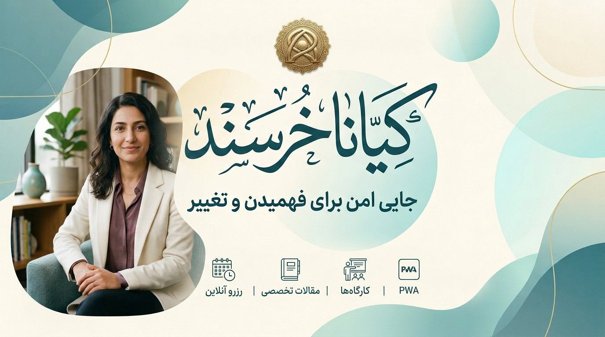

<p align="center">
  <h1 align="center">کیانا خرسند — Kiana Khorsand</h1>
  <p align="center">جایی امن برای فهمیدن و تغییر · A Safe Space to Understand and Change</p>
</p>

<p align="center">
  <a href="https://nextjs.org"></a>
  <a href="https://www.typescriptlang.org"></a>
  <a href="https://tailwindcss.com"></a>
  
  
</p>

> **فارسی RTL** وب‌سایت درمانی مدرن با Next.js 16 App Router، MongoDB و PWA. کاملاً سبک، سَبک‌وزن، ریسپانسیو از 320px تا دسکتاپ — بدون پرش، بدون فلش.

---

## ✨ ویژگی‌ها

### 🌿 صفحات عمومی
- هوم مدرن با هیرو شناور، کاروسل مقالات/کارگاه‌ها/نظرات (coverflow)، تایم‌لاین و CTA شیشه‌ای
- حوزه‌ها، مقالات با سرچ/فیلتر/پیجینیشن 6تایی + نشان خودکار از عنوان، حوزه‌ها با جزئیات
- کارگاه‌ها با تقویم شمسی، رزرو آنلاین، نظرات تأییدشده
- درباره من، روش کار، تعرفه‌ها، پرسش‌های متداول

### 🔐 احراز هویت
- ورود/ثبت‌نام با **موبایل + رمز عبور** (Better Auth)
- نقش‌ها: `user` / `admin` ، محافظت Server Action، `headers()` امن

### 👤 داشبورد کاربر
- نوبت‌ها، یادداشت‌ها، پرداخت‌ها، پیام‌های خصوصی با ادمین
- آپلود آواتار (WebP مربعی بدون EXIF، 750KB)

### 🛡️ پنل ادمین
- مدیریت مقالات (Markdown + پیش‌نمایش زنده)، خدمات، کارگاه‌ها، حوزه‌ها
- تقویم تعاملی روز/هفته/ماه + بستن بازه تعطیلی، صدور فاکتور دستی

### 📲 PWA
- `manifest.webmanifest` (standalone, RTL, theme #0d736b)
- `sw.js` آفلاین سبک (cache-first assets, network-first navigate)
- آیکون‌های 192/512/maskable + Apple Touch

---

## 🚀 پرفورمنس و بهینه‌سازی

طبق چک‌لیست رسمی Next.js 16 Production:

- **Turbopack** پیش‌فرض — بیلد ~17s، HMR <50ms
- `experimental.optimizePackageImports: lucide-react, motion, zod` + تفکیک `radix-ui` به پکیج‌های جدا
- `images: avif/webp`, `compress:true`, `poweredByHeader:false`
- Server Components پیش‌فرض — فقط داک/منو/فرم‌ها Client هستند
- انیمیشن‌های تزئینی با **CSS خالص** (`@keyframes`, `motion-safe`) — Motion فقط برای پیل داک
- فونت Vazirmatn با `next/font/local` + `preload` و `display:swap` — بدون CLS
- `viewport-fit: cover` + `safe-area-inset` برای ناچ موبایل

| متریک | قبل | بعد |
|---|---|---|
| JS انتقالی (Prod) | ~954 KB | **~364 KB** |
| Client Components | 60 | **<40** |
| صفحات استاتیک/داینامیک | 82 | 82 (بدون رگرسیون) |

---

## 🛠️ استک

- **Framework:** Next.js 16.4 (App Router) + Turbopack
- **UI:** Tailwind 4, lucide-react, Radix UI (تفکیک‌شده), motion (فقط داک)
- **DB:** MongoDB 7 + better-auth + Zod
- **PWA:** @ducanh2912/next-pwa + دستی sw.js
- **Date:** @daypicker/persian, Jalali picker
- **Font:** Vazirmatn (WOFF2)

---

## 📂 ساختار

```
src/
├── app/                 # layout, manifest, sitemap, robots, (public)/(auth)/(panels)
├── components/          # layout (header/dock/footer), ui, shared
├── features/            # articles, areas, workshops, booking, testimonials ...
├── actions/             # Server Actions (auth, admin, booking, contact)
├── lib/                 # env, auth, motion-tokens, site-urls
├── db/                  # Mongo client, indexes, seed
└── validations/         # Zod schemas
public/
├── assets/              # fonts, images (hero, intro, og)
├── cover.jpg            # ✨ کاور README
├── icon-*.png / sw.js   # PWA
└── og-image.png
```

> `scripts/` حذف شد — پروژه برای اجرای پروداکشن به اسکریپت Dev نیاز ندارد.

---

## 🏁 شروع سریع

**پیش‌نیاز:** Node.js 20, npm, MongoDB Atlas

```bash
git clone https://github.com/rezaian-dev/kiana-khorsand.git
cd kiana-khorsand
cp .env.example .env.local  # مقادیر MONGODB_URI, BETTER_AUTH_SECRET, SITE_URL را پر کنید
npm ci
npm run seed        # داده اولیه (تکرارپذیر)
npm run dev         # http://localhost:3000
```

**متغیرهای محیطی (.env.local):**

```env
MONGODB_URI=mongodb+srv://...
MONGODB_DB=kiana-khorsand
BETTER_AUTH_SECRET=...
BETTER_AUTH_URL=http://localhost:3000
SITE_URL=http://localhost:3000
```

**اسکریپت‌ها:**

| دستور | توضیح |
|---|---|
| `npm run dev` | Turbopack dev |
| `npm run build` | بیلد پروداکشن (82 صفحه) |
| `npm run start` | اجرای پروداکشن روی 3000 |
| `npm run lint` | ESLint |
| `npm run typecheck` | tsc --noEmit |

---

## 📱 موبایل داک — انیمیشن زیبا

- شیشه‌ای `bg-white/85 backdrop-blur-2xl` با `border-white/60` و سایه تیل
- پیل فعال گرادیان `teal-600→emerald-600` + `spring 400/30`
- فیدبک لمسی `vibrate(10)`، `prefetch`، `safe-area` و ریسپانسیو 320px (`inset-x-2` در موبایل کوچک)

---

## 🔒 امنیت

- `X-Content-Type-Options: nosniff`, `X-Frame-Options: SAMEORIGIN`
- Server Actions همه مجوزها را دوباره چک می‌کنند
- تصاویر آواتار در سرور به WebP بدون EXIF تبدیل می‌شوند

---

## 📄 لایسنس

MIT — نمونه‌کار آموزشی، سامانه درمانی واقعی نیست.

---

<p align="center">ساخته شده با 🤍 برای تجربه‌ای آرام و حرفه‌ای</p>
